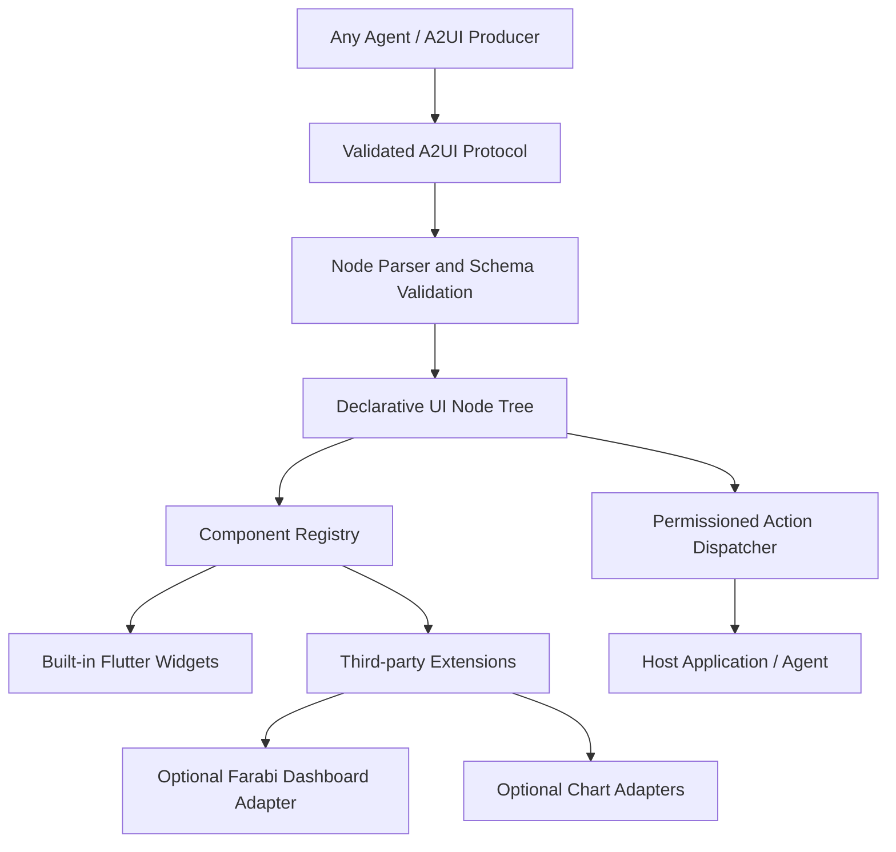
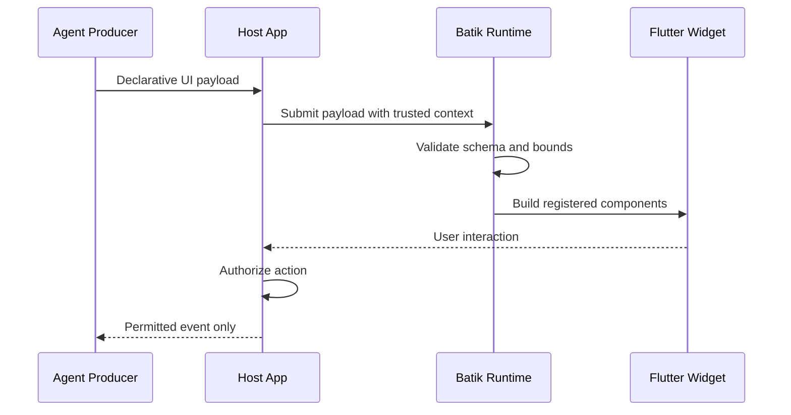
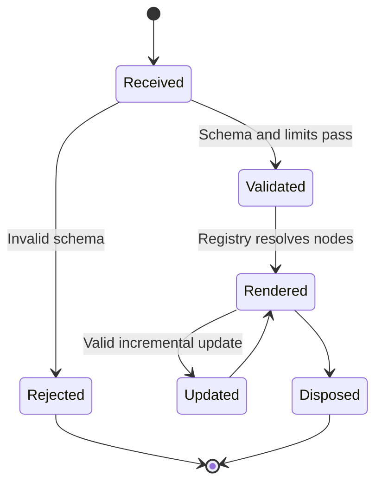

# Batik Architecture Blueprints

> Target architecture. Batik remains a model-agnostic Flutter framework for agent-driven UI; Farabi is one consumer, not a dependency.

## Component architecture

## UI update and action sequence

## Component lifecycle

## Architectural rules

- Core widgets and A2UI contracts must remain agnostic to Farabi, Toba, and any one model provider.
- Custom extensions are registered through stable APIs; unknown components fail safely.
- UI actions are requests, never authority to execute privileged operations.
- Validate payload depth, size, allowed actions, and resource usage.
- Preserve accessibility, lifecycle cleanup, testability and Flutter compatibility.
